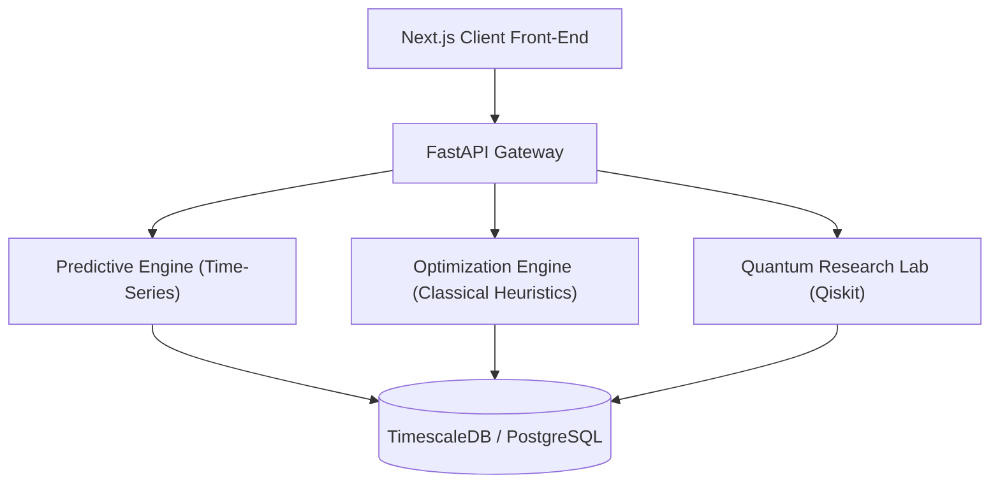

<div align="center">

# QSCI: Quantum Supply Chain Intelligence

**From Supply Chain Signals to Intelligent Decisions.**

[](https://nextjs.org/)
[](https://fastapi.tiangolo.com/)
[](https://reactjs.org/)
[](https://qiskit.org/)
[](LICENSE)

QSCI is an **Enterprise Decision Intelligence Platform** that unifies predictive forecasting with advanced mathematical optimization and quantum-ready algorithms (QAOA) to deliver financially quantified, explainable business decisions for global supply chains.

[Explore the Platform](#) • [Read the Research](#) • [Documentation](#)

</div>

---

## 📖 Table of Contents
- [The Research Gap](#-the-research-gap)
- [The Decision Pipeline](#-the-decision-pipeline)
- [Features](#-features)
- [System Architecture](#-system-architecture)
- [Getting Started](#-getting-started)
- [Project Structure](#-project-structure)
- [Classical vs Quantum Benchmarks](#-classical-vs-quantum-benchmarks)
- [Contributing](#-contributing)
- [License](#-license)

---

## 🔍 The Research Gap

Existing supply chain AI focuses heavily on **prediction** (forecasting demand, estimating lead times) but fails at **decision-making**. Knowing that demand will spike doesn’t tell a planner what to order, when to order it, and how to route it through a multi-echelon network while minimizing holding costs and maintaining service-level agreements (SLAs).

**QSCI bridges this gap.** It maps predictive outputs into constrained optimization spaces, outputting direct, financially quantified recommendations that human operators can trust and approve.

---

## ⚙️ The Decision Pipeline

Our end-to-end intelligence pipeline follows 7 critical steps:

1. **DATA:** Ingest diverse ERP and market signals.
2. **PREDICT:** High-dimensional time-series forecasting.
3. **OPTIMIZE:** Stochastic routing and multi-echelon inventory optimization.
4. **QUANTIFY:** Attach a strict financial impact (Revenue at Risk vs. Holding Cost).
5. **EXPLAIN:** Decompose the AI’s confidence into human-readable drivers (SHAP).
6. **DECIDE:** Present the recommendation to the human planner (Decision Center).
7. **LEARN:** Feed the human's approval/override back into the models.

---

## ✨ Features

- **Decision Center (Inbox-Style UI):** A prioritized queue of actionable exceptions, not just raw metrics.
- **Explainable AI (XAI) "Why Panels":** Every recommendation includes a 4-pillar confidence breakdown (Data Quality, Forecast Uncertainty, Model Consensus, Historical Backtest).
- **Multi-Echelon Inventory Hub:** Visualize network-wide holding costs and in-transit units.
- **Quantum Research Lab:** Side-by-side benchmarking of Classical Solvers (Tabu Search, Simulated Annealing) against Quantum-Ready algorithms (QAOA, QUBO).
- **Role-Based Workflows:** Distinct Adaptive UIs for Executives, Planners, and Researchers.

---

## 🏗 System Architecture

The platform follows a decoupled, hybrid architecture:



- **Frontend:** Next.js (App Router), Tailwind CSS, Recharts, Lucide Icons.
- **Backend:** FastAPI, Pydantic, SQLAlchemy.
- **Data/ML:** Scikit-Learn, PyTorch, LightGBM.
- **Quantum:** IBM Qiskit (QAOA implementations for Vehicle Routing & Inventory).

---

## 🚀 Getting Started

### Prerequisites
- Node.js (v18+)
- Python (3.10+)
- Git

### Installation

1. **Clone the repository:**
   ```bash
   git clone https://github.com/Piush2004/QSCI-Platform.git
   cd QSCI-Platform
   ```

2. **Start the Frontend Development Server:**
   ```bash
   cd frontend
   npm install
   npm run dev
   ```
   The UI will be available at `http://localhost:3000`.

3. **Start the Backend API:**
   ```bash
   cd backend
   pip install -r requirements.txt
   uvicorn app.main:app --reload
   ```

---

## 📂 Project Structure

```text
QSCI-Platform/
├── frontend/                 # Next.js web application
│   ├── src/
│   │   ├── app/              # App Router (Pages & Layouts)
│   │   │   ├── dashboard/    # Decision Center
│   │   │   ├── inventory/    # Multi-echelon Network Hub
│   │   │   ├── research/     # Classical vs Quantum Benchmarks
│   │   │   └── globals.css   # 4-Mode Design System (Marketing, Decision, Research, Infra)
│   │   └── components/       # Reusable React components
├── backend/                  # FastAPI Python backend
│   ├── app/
│   │   ├── api/              # RESTful API endpoints
│   │   ├── services/         # Core business logic (Forecast, Optimization, MLflow)
│   │   └── db/               # SQLAlchemy models & migrations
├── mlops/                    # ML tracking, DVC, Model Drift scripts
├── paper/                    # IEEE formatted LaTeX research paper & raw experiment code
└── tests/                    # Stress tests & Chaos engineering agents
```

---

## ⚛️ Classical vs Quantum Benchmarks

The QSCI Research Lab actively benchmarks the transition from classical computing to quantum advantage. 
Currently, classical heuristics (Simulated Annealing) can solve 10,000+ node networks in minutes. Quantum algorithms (QAOA) are formulated as QUBO problems and tested on quantum simulators for sizes of 50-100 qubits, preparing the enterprise for future fault-tolerant hardware.

---

## 🤝 Contributing

We welcome contributions! Please read our [Contributing Guidelines](CONTRIBUTING.md) before submitting a Pull Request.

1. Fork the Project
2. Create your Feature Branch (`git checkout -b feature/AmazingFeature`)
3. Commit your Changes (`git commit -m 'Add some AmazingFeature'`)
4. Push to the Branch (`git push origin feature/AmazingFeature`)
5. Open a Pull Request

---

## 📄 License

Distributed under the MIT License. See `LICENSE` for more information.

<div align="center">
  <sub>Built with ❤️ by Piush and the QSCI Team.</sub>
</div>
